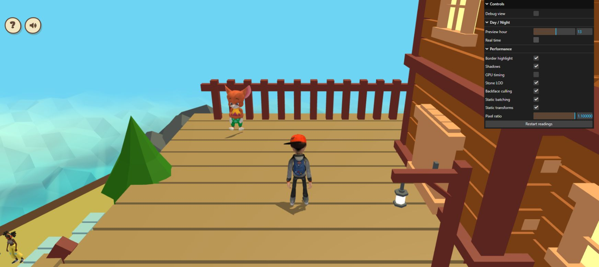
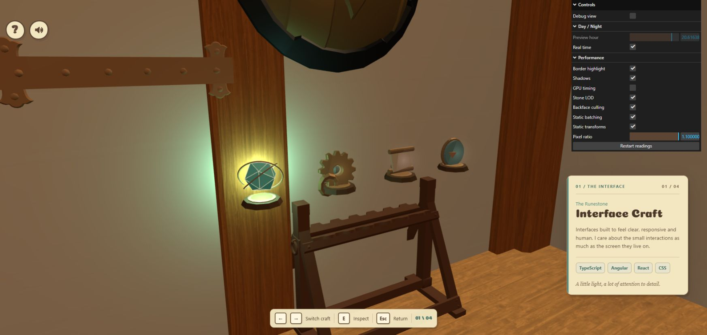
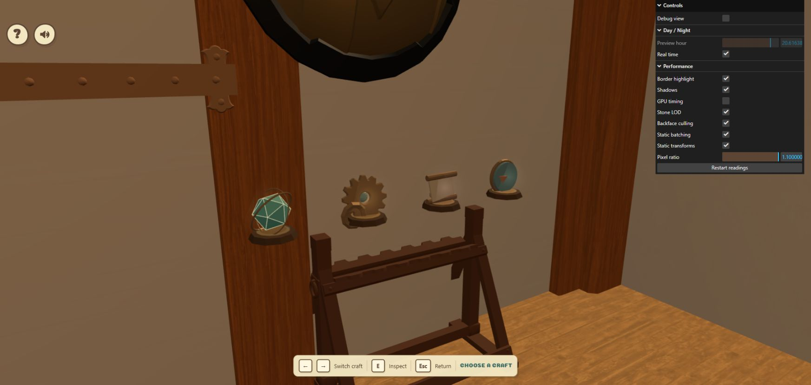
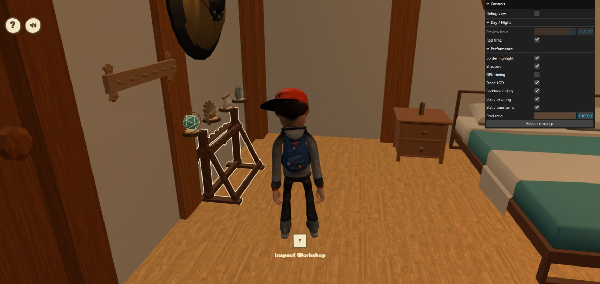
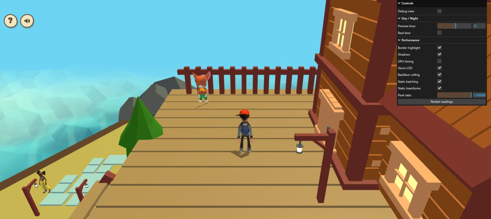
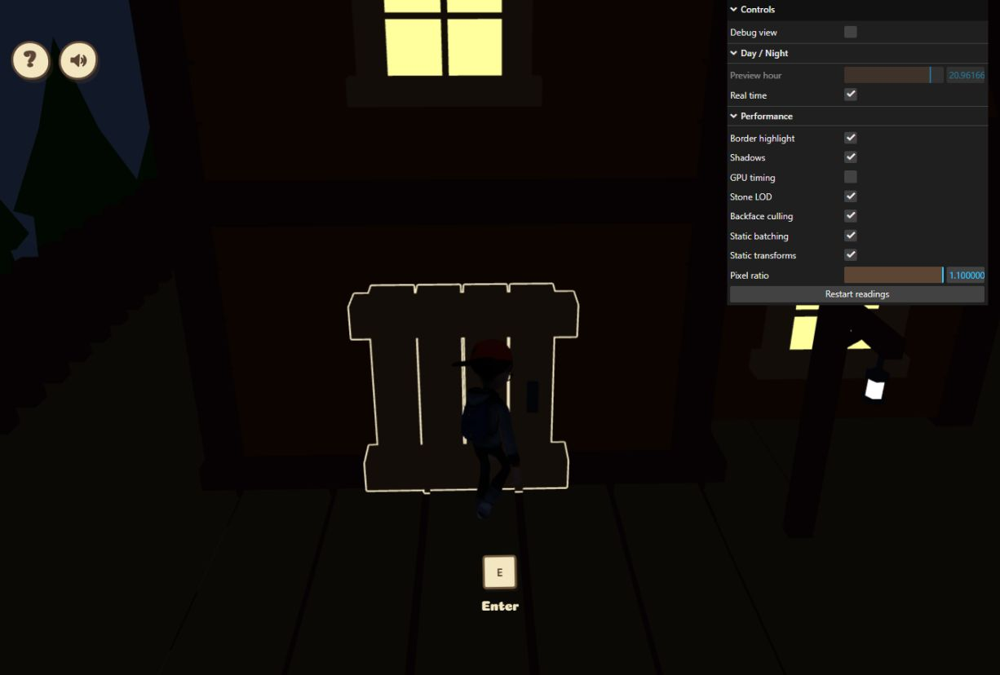
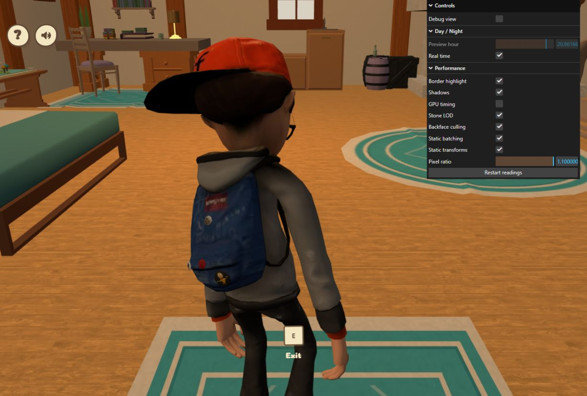
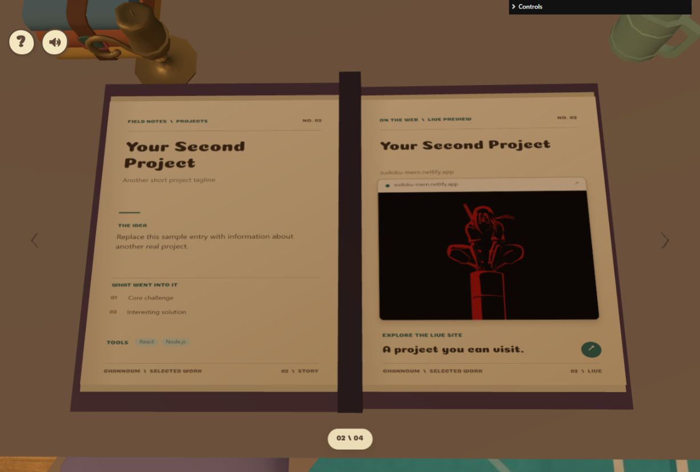
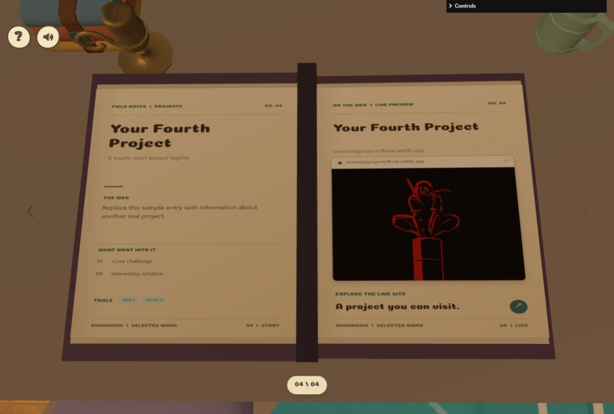
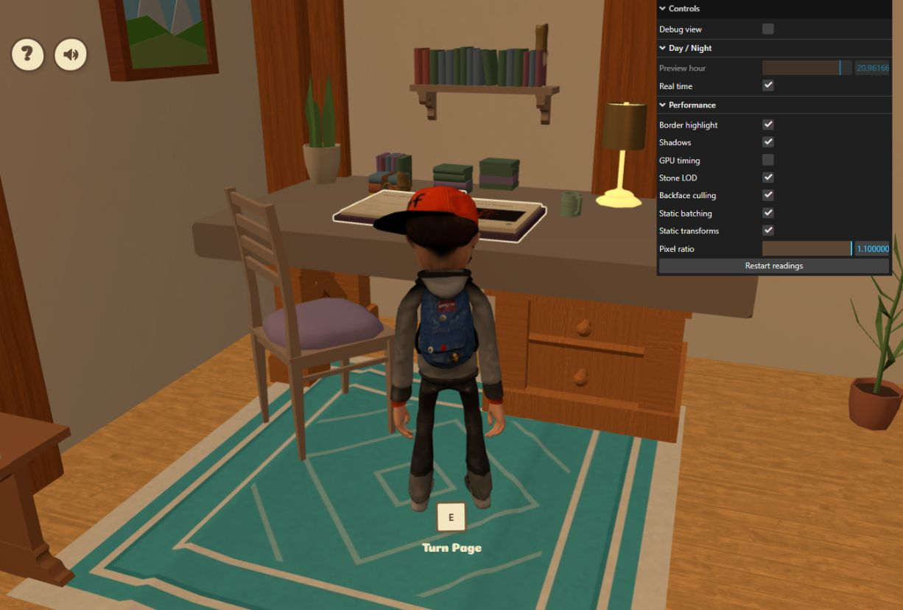

# Common performance pass: live browser check

Date: 2026-10-23. Local development site: `http://localhost:5173/` and
`http://localhost:5173/?perfdiag=1`, using the user's connected Chrome browser.
Source under review: feature head `f4144381085e674622dd61295fe31a7e3d91f323`.

A fresh diagnostic page completed initial loading and emitted
`[World static scene] Object` at `2026-10-23T17:48:25.170Z`. This confirms the new
startup path ran. The browser UI does not expose the local Git commit; the exact
Windows checkout SHA was not independently read. The logger's object fields were
not expanded by the browser tool, so no live instance count is inferred from it.

## Results

| Check | Observed result | Evidence / limit |
| --- | --- | --- |
| Essential startup | Loading cover finished; intro, world guide, player, NPCs and exterior appeared | Fresh diagnostic tab; not a cold-cache or production-load measurement |
| Exterior batching appearance | Fence, planks, tree, house, lamps and visible rocks retained their appearance when Static batching was disabled and enabled | Same camera, preview hour 13, quality switches enabled; animated characters differ between captures |
| Workshop entry | E opened the workshop from the existing nearby house position | Overview screenshot |
| Four artifacts | E opened Interface Craft; right arrows selected Systems & Logic, Creative Engineering and The Developer's Kit | All four selected-skill regions were read successfully |
| Inspection lights | Selected artifact glowed during inspection; E hid its details and returned to an unlit overview | Inspection and overview screenshots; no private scene-state reads |
| Hover and stand borders | Hover showed the Runestone hint without filling its surface; after Esc, the stand had a thin cream border with its brown material retained | Border screenshot after returning to the house |
| Return from workshop | Esc restored third-person house view and the Inspect Workshop hint | Border screenshot |
| Cottage exit/reentry | From the user-positioned doorway, E restored the exterior and Enter hint; another E restored the furnished house and Exit hint | One complete cached cycle; exit and reentry screenshots; no error-level console entries returned |
| Projects Book | E opened the book; all four numbered spreads rendered; Next, E and Right Arrow advanced; Left Arrow and Previous moved back; end buttons disabled correctly | Page 2/page 4 captures and accessible page counters; transitions were checked after their animations |
| Return from book | Esc restored the third-person house and hid page controls; the open book retained its thin border and Turn Page proximity hint | Book-return capture; no error-level console entries returned |
| Camera input smoke check | Indoor drag changed the view; exterior wheel input changed zoom and the opposite scroll returned it | Zoom screenshot; this does not establish complete wall-collision coverage |
| Console errors | No error-level entries were returned for the diagnostic house/workshop tab or fresh exterior tab at the end of the checks | Captured browser logs only; not a claim that every warning or device is clean |

An idle-house diagnostic record at `2026-10-23T17:46:08.519Z` reported
`pointLights: 1`, `highlightMode: "border"`,
`postprocessOutlineActive: false` and `workshopLights: "inspect"`.
Inspection lighting was assessed visually; this record is an idle-house sample.

The door follow-up started at `2026-10-23T17:59:23.848Z`. The user first walked
the character to the indoor doorway. The agent then performed both E interactions
and checked each hint and rendered scene. The reentry view was close to the player
near the entrance wall; the room remained rendered. This is a transition smoke
check, not a complete camera-collision route or a transition-latency measurement.
No quality controls were changed during this follow-up.

The book follow-up ran from `2026-10-23T18:06:40.326Z` to
`2026-10-23T18:13:53.494Z`, starting from the user-positioned desk. The observed
sequence was 01 -> 02 (Next button) -> 03 (E) -> 04 (Right Arrow) -> 03
(Left Arrow) -> 02 -> 01 (Previous button twice). Previous was disabled on 01,
and Next was disabled on 04. Each spread showed its project heading and preview
image. Existing placeholder project copy and repeated preview artwork were not
edited or treated as proof of the linked live sites. Opening those sites via O
or a screenshot click was outside this check.

Page controls disappear while animations run. An early arrow gesture while the
controls folder was focused did not advance the page, and one automation wait
expired during a turn; subsequent visible page counters confirmed navigation.
These observations were not console/application errors. The controls folder was
temporarily collapsed for unobstructed book captures and restored afterward.
Esc returned to the house with the physical book still open and the hint
`Turn Page`; no claim is made that Esc closes the physical book.

## Screenshots

Initial exterior screenshots are 1745 x 777; initial workshop/house screenshots
are 1745 x 828. The door and book follow-up captures are 1226 x 828. The browser viewport
changed between those groups. Each on/off pair uses the same viewport. These are
original browser captures, without image editing.

### Exterior batching enabled

### Exterior batching disabled

### Workshop inspection

### Workshop overview after hiding inspection

### House border after returning

### Exterior zoom input

### Cottage exit

### Cottage reentry

### Projects Book page 2

### Projects Book page 4

### House after returning from the book

## Remaining verification

- Other furniture inspection modes after this pass, including Awards Hall and map.
- Longer player movement and a complete camera wall-collision route. The browser's
  press/release key gestures produce very small walking steps; repeated taps did
  not provide reliable traversal. No hidden game methods or synthetic page events
  were used to reposition the player. The book follow-up left the house tab beside
  the desk; the later timing check observed a post-capture reload and restored the
  diagnostic tab at the exterior spawn.
- A clean single-instance benchmark and cold-load latency. The later
  [same-view batching comparison](common-performance-timing-2026-10-23.md) captures
  CPU/GPU windows for this pass, with browser-workload and timing-drift limits.
  The older reports remain historical rather than before/after benchmarks.

No runtime source changes were needed during this check. The previously passing
84 tests, typecheck and production build remain the source-validation result;
they were not rerun for this documentation-only update. Temporary controls were
restored, including Static batching enabled and Real time enabled. The temporary
exterior diagnostic tab was closed; the user's two original local tabs remain.
