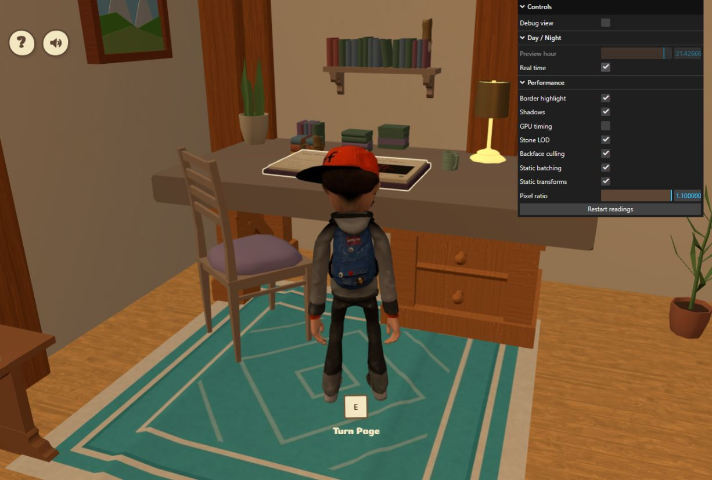
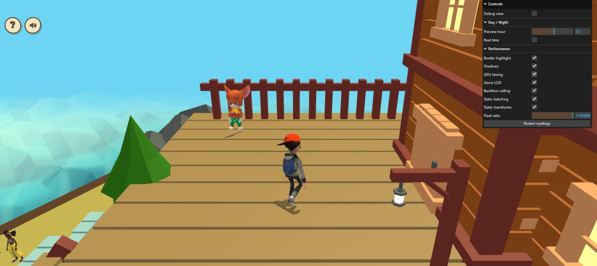
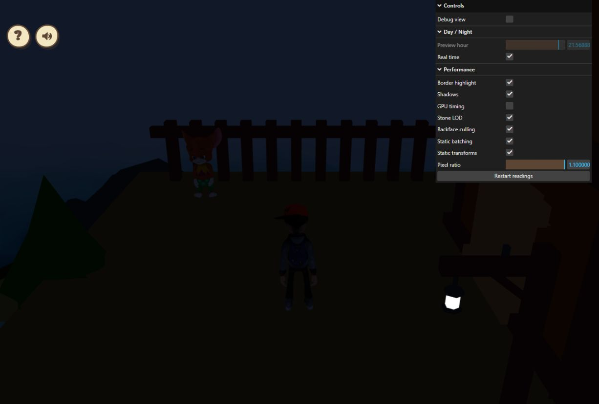

# Same-view batching CPU/GPU comparison, 2026-10-23

Batching consistently reduced submitted draw calls in both tested views without
changing triangle counts. CPU/GPU timing varied between repeated baselines, and
these captures do **not** establish a consistent FPS gain or regression.

Source under review: `8b9bb21a10340936961d1d0adba0e691cc36d2ab`; its runtime
changes are unchanged from `f4144381085e674622dd61295fe31a7e3d91f323`.
The exact Windows checkout commit was not independently read. A fresh exterior
page emitted the new static-scene startup log at 18:26:07.503Z.

## Method and scope

The user's connected Chrome ran `http://localhost:5173/?perfdiag=1`.
Each view used batching **on -> off -> on**. The existing switch controls merging
and exterior instancing together; this is not an isolated instancing test.

Each condition used Restart readings, the application's two-second warm-up
exclusion, at least a 22-second quiet wait, and the last five renderer/profile
windows after that reset. Each window lasts about three seconds. No screenshots
or gameplay inputs were requested during the wait. Remote-control/log-reading
overhead still exists. Tables contain medians of window summaries; GPU ms is the
median of each window's sampled mean, not a pooled GPU percentile. CPU/GPU work
can overlap; the columns must not be added as a frame-budget equation.

The camera stayed fixed within each view. Idle character/NPC animations continued.
Shadows, borders, stone LOD, backface culling, static transforms, beam batching,
resolution and lighting policy stayed enabled. GPU timing was enabled only for
measurement. Preview hour was frozen separately for each view.

| View | CSS viewport | Framebuffer | DPR | Preview hour | Point lights | Active border |
| --- | --- | --- | ---: | ---: | ---: | --- |
| Indoor book approach | 1226 x 828 | 1348 x 910 | 1.1 | 20.9617 | 1 | Yes |
| Exterior spawn/deck | 1745 x 777 | 1919 x 854 | 1.1 | 13 | 0 | No |

Dimensions were read before/after each set, not continuously. The groups have
different viewport sizes and scenes; their absolute timings are not comparable.

## Results

| Condition | Draws | Triangles | FPS | Callback CPU ms | Renderer CPU ms | Sampled GPU ms | Callback interval ms |
| --- | ---: | ---: | ---: | ---: | ---: | ---: | ---: |
| A1 batching on | 92 | 34,428 | 30 | 4.35 | 3.16 | 12.90 | 33.51 |
| B batching off | 110 | 34,428 | 29 | 5.67 | 4.70 | 12.94 | 34.86 |
| A2 batching restored | 92 | 34,428 | 29 | 5.09 | 4.17 | 12.95 | 34.46 |
| Exterior A1 batching on | 149 | 353,420 | 7 | 16.76 | 14.67 | 23.72 | 140.44 |
| Exterior B batching off | 176 | 353,420 | 16 | 11.45 | 9.93 | 21.78 | 58.63 |
| Exterior A2 batching restored | 149 | 353,420 | 16 | 12.45 | 10.85 | 21.55 | 58.80 |

- Indoor draw calls: **110 -> 92**, 18 fewer (**16.4%**), with **34,428** triangles.
- Exterior draw calls: **176 -> 149**, 27 fewer (**15.3%**), with **353,420** triangles.
- All 30 renderer windows and 30 callback-profile windows were retained in the
  selected data. GPU timing reported ready, with **188 completed samples**,
  no disjoint events and at most three unresolved queries.
- Indoor enabled runs had lower callback/renderer CPU medians than the disabled
  run, but the enabled baselines also drifted. No precise CPU percentage is
  attributed to batching. GPU time stayed around 12.9 ms and FPS stayed 29-30.
- Exterior timings changed substantially between the first and restored baseline.
  The restored enabled and disabled runs both reported 16 median FPS. The first
  enabled run's 7 FPS is retained rather than discarded. These readings do not
  establish a batching-related FPS benefit or regression.

GPU resource counters were 303 -> 336 -> 336 geometries indoors and
161 -> 192 -> 192 outside; texture counts stayed at 62 and 34 respectively.
This is consistent with first uploading the original unbatched geometry and
retaining its buffers for later toggles. It is not a repeated-toggle leak test.

## Limits and cleanup

The original two portfolio tabs stayed open; a temporary third tab hosted the
exterior test. Independent DOM reads returned visible for all three. That does
not establish their simultaneous execution state, but competing rendering work
could not be excluded. This is a same-view comparative capture under the observed
browser workload, **not a clean single-instance benchmark**. No full Chrome
Performance trace was taken. These measurements are from a Vite development
server and do not measure production cold startup, the new loading overlap or
the isolated camera-query cache.

The original house tab's GPU timer was disabled and Real time restored before
the exterior test. After all captures, both pages returned to the intro during
cleanup. The temporary page's fresh startup log was at **18:34:10.724Z**, after
the last capture ended at **18:33:42.085Z**. The cause of the reload was not
determined. The first attempt to access its now-hidden timer control failed;
the temporary tab was then closed.

The original diagnostic tab was taken through the intro again. Its default
quality switches and Real time were verified enabled, GPU timing disabled,
DPR 1.1. Its character is now at the exterior spawn rather than beside the book.
No error-level console entries were returned from the captured house/exterior
logs. No runtime source changes were needed. The previously passing 84 tests,
typecheck and build were not repeated for this documentation-only update.

The local workspace became unavailable while saving this report. This
documentation-only update was published through the repository connection; no
local commit or new build was performed.

Raw data: [all selected windows and metadata](common-performance-timing-2026-10-23.json).

## View evidence

The house image was captured after its settings were restored, with the same
camera but a resumed real-time clock; it is not a timed frame.

The exterior image shows the fixed daylight view before timed sampling.

The final image verifies defaults after the post-capture reload.

