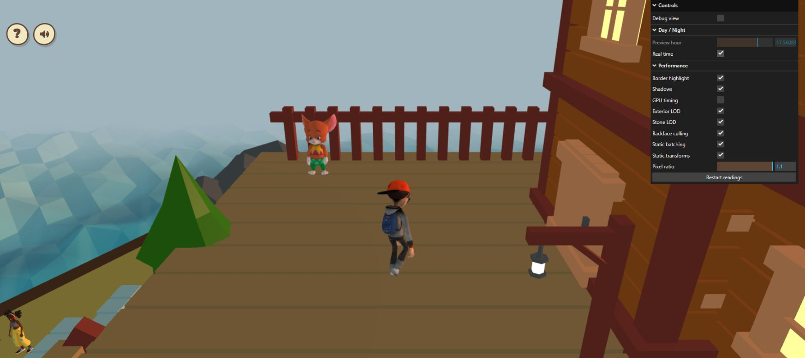

# Exterior GPU timing check — October 26, 2026

A fixed gameplay camera at the cottage spawn was sampled through the existing
diagnostic controls. Each condition ran for 18 seconds after its switch/reset;
the last five renderer and five callback windows were retained. Restarting
readings invokes the existing two-second warmup exclusion. Inactive portfolio
tabs and other machine work were not controlled. The localhost tab initially
showed connection refused; one reload loaded the app and its rules screen was
closed before gameplay capture.

The sequence was A1 → B → A2 → C → A3 → D → A4:
A = DPR 1.1, shadows and exterior LOD on;
B = shadows off; C = DPR 0.75; D = exterior LOD off.
All other settings and the camera stayed fixed at preview hour 13.
DPR 0.75 was a diagnostic only.

| Condition | Draws | Triangles | GPU ms* | Renderer CPU ms* | FPS* | GPU queries |
| --- | ---: | ---: | ---: | ---: | ---: | ---: |
| A1 | 149 | 221,476 | 23.46 | 13.18 | 19 | 29 |
| B | 144 | 201,252 | 19.66 | 5.35 | 22 | 34 |
| A2 | 149 | 221,476 | 20.58 | 4.17 | 22 | 32 |
| C | 149 | 221,476 | 11.55 | 6.29 | 24 | 34 |
| A3 | 149 | 221,476 | 20.53 | 5.28 | 22 | 32 |
| D | 149 | 353,420 | 20.92 | 5.74 | 22 | 33 |
| A4 | 149 | 221,476 | 20.59 | 7.17 | 20 | 30 |

\* Medians across the five reporting windows. GPU ms is the median of window
GPU means, not a pooled per-frame median. FPS is the application's reported
approximation, not a separate presentation-rate measurement. All **224 completed
GPU queries** were reported ready with zero disjoint events; pending queries
remained bounded at one in these windows. The JSON retains all 35 renderer and
35 callback windows, including the slower initial baseline.

## Findings

The normal-DPR baselines settled around 20.5–20.6 ms after A1's 23.46 ms.
A2 / C / A3 measured 20.58 / 11.55 / 20.53 ms with unchanged draw and triangle
counts. The framebuffer changed from 1919 × 854 to 1308 × 582, while the CSS
viewport stayed 1745 × 777. This is strong evidence of substantial pixel-dependent
GPU cost in this view, including possible fragment shading, fill or bandwidth.
It does not isolate water, lighting, textures, antialiasing or another individual
material. Resolution was restored; the lower-DPR condition is not an optimization
shipped by this report.

Shadows off measured 19.66 ms, compared with the following A2 baseline of
20.58 ms. The earlier A1 drift makes the apparent larger improvement unreliable.
The switch removes five draws and 20,224 submitted shadow triangles at this
camera/hour. This does not establish that disabling visible shadows is an
acceptable quality tradeoff.

Exterior LOD off measured 20.92 ms, bracketed by A3 20.53 and A4 20.59 ms.
It adds exactly 131,944 triangles with unchanged draw count. This is a small
timing separation and overlaps variation within the baseline windows; it
establishes geometry reduction more strongly than an isolated GPU/FPS gain.
Short FPS windows mostly stayed near 22 despite the pixel-count GPU change.
No consistent general FPS improvement is claimed.

The next measurement should isolate material/fragment cost at native resolution,
starting with the large visible water surfaces and shadow receiving, while
checking the appearance at the same camera and hour. Source inspection shows
custom animated water fragments inside standard lit materials, but the present
data does not prove water is the dominant material. Further geometry LOD is
not the main hypothesis suggested by this resolution comparison.

## Cleanup and scope

DPR 1.1, Shadows on, Real time on and GPU timing off were restored. Exterior LOD
was left on, matching the agreed current default. Debug view remained off.
Border highlights, house stone LOD, surface culling, static batching/transforms
and other quality defaults stayed enabled. No error-level console entries were
returned. The live path supports the new switch, but the browser source revision
was not independently fingerprinted; Exterior LOD was off on entry and enabled
manually for the comparison. The recorded remote feature head was
`2d842503bf24a6e1dc9ced5ee3cca0f9f55ecbdf`.

No runtime source, assets or dependencies change in this follow-up. No additional
unit suite was needed for this read-only profiling/documentation pass. Existing
95-test/typecheck/build results refer to the preceding implementation.

[Raw windows and settings](exterior-gpu-check-2026-10-26.json).

