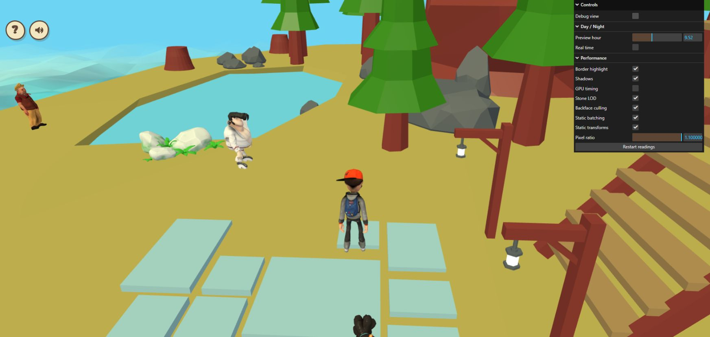

# Live exterior LOD comparison

The `?perfdiag=1` Performance folder now has an **Exterior LOD** switch,
separate from the existing house **Stone LOD** switch. Exterior LOD remains
off by default; `exteriorLod=1` still opts in at startup.

Turning the switch on loads and validates the optional sidecar once. Turning it
off immediately restores the authored indices. Disabling while the download or
hash checks are pending also keeps full detail when preparation completes.
Repeated requests share the pending work; failed downloads can retry on the
next enable. Collider geometry, camera and player position do not change.
Renderer logs include the requested switch state; `[House physics]` includes
the actual selected triangle counts when optional data is ready.

After pulling the branch, compare at one unchanged camera/time/DPR:

1. Open `http://localhost:5173/?perfdiag=1&exteriorLod=1`.
2. Toggle **Exterior LOD** off/on. Allow readings to settle after each switch.
3. Inspect the two detailed pale rock/plant meshes near the pond, first at
   distance, then close up. Check silhouettes, texture seams, shading and the
   transition while moving. Keep borders/shadows and other controls consistent.

The switch resets diagnostic readings using the existing warmup policy. It
does not pause NPC animation or other machine work, so an FPS claim still needs
repeated same-view measurements with controlled load.

Validation on October 24, 2026 (Beirut): 95 local tests, typecheck, build and
whitespace checks passed. The new regression uses the actual shipped world and
sidecar, simulates an offline failure and delayed completion, then checks
deduplication, retry, late disable, distant selection and restoration. Local
house-dependent checks use the prior house export; the owner previously reported
all 93 tests passing on the newer house. Existing build warnings remain.

The owner's browser still showed the preceding build during this change; the
new switch has not been clicked live yet. Debug view was turned off after the
review attempt, normal gameplay rendered, and no error logs were returned.
The matched close-up comparison remains pending; exterior LOD stays opt-in.
The debug camera was panned during review, so its pose differs from the previous
wide-view captures. Player position also changed during the browser session.

See [earlier live readings and limits](exterior-lod-live-2026-10-23.md) and
[geometry/source audit](exterior-geometry-audit-2026-10-23.md).
