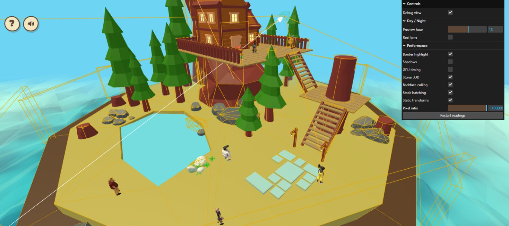
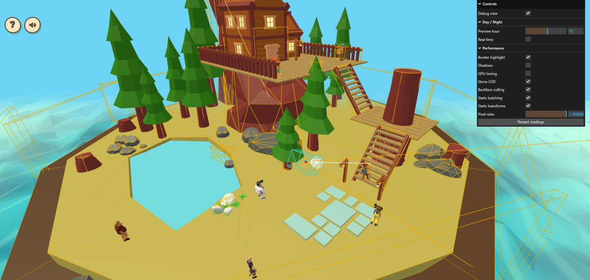
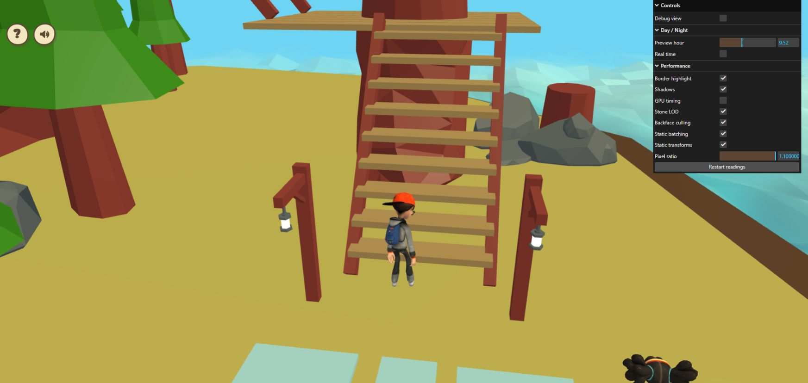

# Exterior LOD live check — October 23, 2026

The opt-in sidecar loaded successfully in the owner's localhost tab. Scrolling
out selected 87,960 triangles across the two targets; a closer camera restored
all 219,904. No error-level console entries were returned from either tab.

| Wide debug overview | Draw calls | Submitted triangles |
| --- | ---: | ---: |
| LOD off | 182 | 371,650 |
| LOD on | 182 | 239,706 |

The difference is 131,944 triangles (35.5% of this baseline frame). It equals
the index-level reduction. Both captures used preview hour 13, DPR 1.1 and
global shadows off to remove differences from the player shadow volume.

These are separate tabs using the default debug-camera pose, with different
player positions and active physics/camera wire overlays. A temporary viewport
override applied only to the baseline: its DOM viewport was 1586 × 706 and
framebuffer 1744 × 776; the opt-in tab remained 1745 × 828 and 1919 × 910.
Therefore these are functional geometry-count observations, not a controlled
FPS/GPU benchmark or pixel-identical visual comparison. The overview has no
obvious large visual discrepancy, but the targets are small and overlays limit
inspection. Full close-up silhouette/UV/shading and walking transitions remain
pending. Keep exterior LOD opt-in.

Cleanup closed only the agent-created baseline tab and reset the viewport
override. The owner's original tab remains at the stairs with Debug view off,
Shadows on, GPU timing off, quality switches enabled and initial preview hour
9.52 restored (Real time remains off as it was on entry). Zoom is closer than on
entry; the full-detail restoration is confirmed by the diagnostic counts.

Raw console windows and DOM measurements: [JSON](exterior-lod-live-2026-10-23.json).

Follow-up: the [October 24 matched review](exterior-lod-matched-review-2026-10-24.md)
uses the live switch at an unchanged camera, checks closer appearance and zoom
restoration, and enables LOD by default with a full-detail opt-out.
