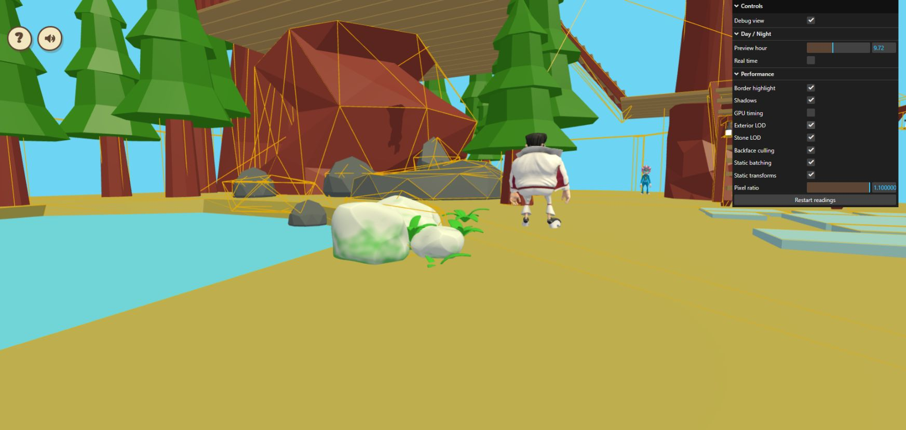
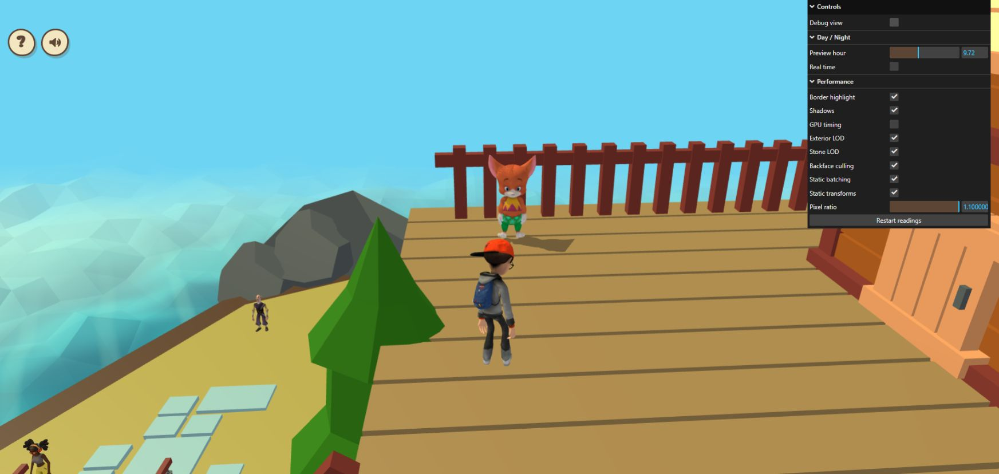

# Matched exterior LOD review — October 24, 2026

The updated diagnostic switch was exercised in the owner's existing localhost
tab. Each off/on pair kept the same camera, viewport, DPR, sunlight and player
position. Unlike the earlier two-tab observations, no page reload or viewport
override occurred between the paired captures.

| View | LOD off triangles | LOD on triangles | Draw calls off / on |
| --- | ---: | ---: | ---: |
| Wide debug overview | 391,552 | 259,608 | 184 / 184 |
| Closer pond targets | 307,098 | 175,154 | 151 / 151 |

Both pairs removed 131,944 submitted triangles, matching the two target meshes'
219,904 → 87,960 index-level reduction. The matched closer screenshots show no
obvious silhouette, texture or shading discrepancy at the inspected angle.
The images are not pixel-identical measurements: JPEG encoding, NPC poses,
shadows and debug helpers can differ.

With Exterior LOD still enabled, one closer zoom restored all 219,904 source
triangles. Zooming back restored 87,960. This verifies the close-up guard and
return to reduced detail in a real rendered scene. These are sampled zoom
observations, not a recorded continuous walking traversal or an all-angle audit.

Settings: viewport 1745 × 828, framebuffer 1919 × 910, DPR 1.1, preview hour 9.72,
Real time off, Shadows on, GPU timing off. Physics/camera overlays were active
during debug views. Short FPS windows drifted; no controlled GPU/FPS gain or
absence of regression is claimed. No error-level console entries were returned.

Following this functional and visual review, the source now enables exterior
LOD by default, retaining `exteriorLod=0` and the live switch as full-detail
comparisons. The 809,223-byte sidecar loads after essential initialization; a
failed or stale sidecar leaves authored geometry. Full close-up geometry,
colliders and materials remain intact. The new default was checked locally;
the live check exercised the same path through the already-pulled switch.

All 95 local tests, typecheck, production build and whitespace checks pass after
the default change. Local house-dependent tests still use the prior house
export; the owner previously confirmed 93 passing with the newer house.
Existing large-chunk and partial-checkout edge-mask warnings remain.

Cleanup restored normal player-camera gameplay with Debug view off. Exterior
LOD was left on. Original preview time 9.72, Real time off, Shadows on, GPU timing
off, DPR and other quality switches were preserved. The debug orbit pose changed
during inspection; normal player-camera controls were not reset or reloaded.

[Raw console windows and settings](exterior-lod-matched-review-2026-10-24.json).

