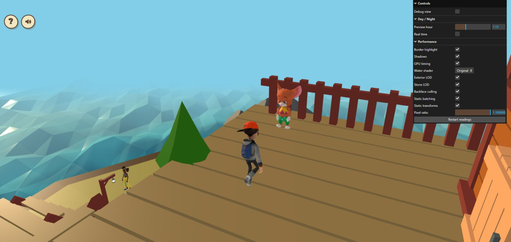
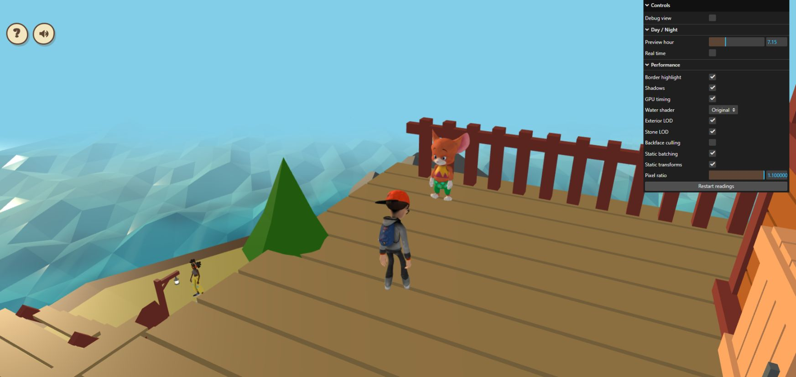

# Verified exterior backface culling

The existing **Backface culling** control now covers verified exterior solids
as well as the house. Normal gameplay enables it; `?surfaceCulling=0` restores
the eligible materials' authored two-sided rendering. The switch under
`?perfdiag=1` changes both scenes, including shared batch/instance materials and
a house that loads after the setting changes.

## Eligible surfaces

The active world, Git blob `97e2f5e33ea4b50f3424db0f0b23f9dd39f88525`, has
**104 eligible meshes, 6,828 source triangles and eight cloned materials**.
These counts describe the surfaces that can reject back-facing triangles;
they are not removed/submitted triangle counts or an FPS measurement.

The same topology and render-state checks used inside the house inspect the
current export. Exact position welding handles UV/normal seams. Every edge must
have two opposite directed uses, with positive signed volume for every connected
shell. Open, degenerate, non-manifold and inward-facing components retain their
authored material. Transparency, alpha cutouts, custom shaders, skinning/morphs,
animation and unsupported render states remain excluded. Only the side of an
owned material clone changes; the authored material is retained for restoration.

The current world's leaves, water and detailed rock materials are not changed
by this pass. Existing exterior LOD continues to control the two dense rock
meshes. Geometry buffers, colliders, object names/hierarchy, textures, vertex
normals, material colors and lighting parameters remain authored.

## Preparation and integration

Exterior preparation limits inspection to **10,000 triangles per mesh**.
Larger meshes keep their original material without topology reads. This avoids
scanning the two dense rock meshes' 219,904 triangles at startup. The house's
existing default inspection limit is unchanged. This budget cannot reduce
geometry detail; it can only leave additional surfaces two-sided.

Player model/animation loading starts before the cooperatively sliced surface
audit, so their downloads overlap. Both finish behind the existing loading
screen before shader/texture preparation. A setting changed during the audit
is reapplied when preparation completes. Failure retains authored materials
and does not block world readiness.

Merging and instancing run after material preparation so front-/double-sided
assignments stay separate. In the actual world, merging still combines 11 meshes
into four batches with 132 triangles; instancing still combines 36 into 16 with
2,200 triangles. The control reuses prepared materials without rebuilding
geometry or batches. Diagnostic `[House physics]` windows now include actual
`exteriorSurfaceCulling` state outside; startup also logs
`[Exterior surface culling]`.

## Validation — October 26, 2026

All **103 local tests**, typecheck, production build and whitespace checks pass.
Four added regressions cover:

- Skipping over-budget topology reads, while retaining the house's default.
- The active-world snapshot, closed/outward checks, material properties, exact
  source stream fingerprints, names/transforms, excluded materials and disposal.
- Player/preparation overlap, changing the setting while preparation is pending,
  shared batch materials and a house created after the setting changes.
- Recovering from preparation failure with authored materials and world readiness.

The existing real house/world and exterior merging/instancing regressions also
exercise the new preparation order and shared culling switches. Local house
checks still use the prior export; the owner's earlier 93-test run covered the
newer house. The world fixture uses the current active asset. No GLB/Blender
source, texture, dependency or Vite configuration changes are part of this pass.

Build entry: 1,017.26 kB minified / 270.70 kB gzip. Required physics remains
2,855.12 / 1,078.39 kB. Existing large-chunk and partial-checkout edge-mask
warnings remain.

The live comparison below now covers native-resolution GPU timing and two
matched visual views in the owner's WebGL page. Submitted draws/triangles remain
unchanged because backface rejection happens during GPU rendering. CPU checks
alone do not establish GPU/FPS or all-angle/pixel equality.

## Live comparison — October 26, 2026

The owner's local page reported the new `exteriorSurfaceCulling` state:
104 meshes, 6,828 eligible triangles and eight materials. The expected branch
head was `6fc1e56b2f6c0613dee8b8ec0c8abd5f351c063d`; the browser source revision
was not independently fingerprinted.

All timed conditions used one unchanged normal cottage-deck gameplay camera
with no camera/player inputs or debug overlays. The owner's fixed preview hour
**7.15**, native DPR **1.1**, CSS viewport **1745 × 828** and framebuffer
**1919 × 910** were held constant. Shadows, border highlighting, exterior/stone
LOD, static batching/transforms and Original water stayed enabled. No point
lights were active. The two exterior LOD targets reported 87,960 selected
triangles throughout.

Each condition used Restart readings with its two-second warmup exclusion,
followed by 18 seconds before collecting the latest five reporting windows.
The GPU column is the median of five window means, not a pooled per-frame
median. CPU and FPS columns are also medians of reporting windows.

| Condition | Culling | GPU ms | GPU window means, ms | Renderer CPU ms | FPS | Queries |
| --- | --- | ---: | --- | ---: | ---: | ---: |
| A1 | On | 19.46 | 19.46, 19.65, 19.55, 19.24, 19.35 | 5.24 | 25 | 38 |
| B | Off | 22.07 | 20.79, 22.07, 21.53, 22.20, 22.20 | 7.51 | 25 | 35 |
| A2 | On | 19.50 | 16.96, 19.50, 19.42, 20.14, 20.42 | 6.73 | 26 | 38 |
| B2 | Off | 21.55 | 21.62, 21.43, 21.68, 21.55, 21.45 | 7.30 | 30 | 44 |
| A3 | On | 19.50 | 19.93, 19.33, 19.46, 19.61, 19.50 | 5.59 | 28 | 40 |

The 25 renderer windows contain **195 completed, ready GPU queries**, with zero
disjoint events and at most one pending query. All windows reported **129 draws
and 200,224 triangles**, with the expected requested culling state. All 25
physics windows confirmed the actual enabled state and 104/6,828/eight counts;
25 callback-profile windows are included in the raw data.

Relative to the surrounding enabled conditions, the two disabled runs cost
about **2.05–2.61 ms** more GPU time. Enabling culling reduced GPU time by about
**9.5–11.8% in this one camera**. The repeated on baselines agree closely, while
FPS varies without a consistent gain. Animation continued, another deployed
portfolio tab remained open, and external load/GPU clocks were uncontrolled.
This supports a view-specific GPU benefit, not a general FPS/device guarantee.

One browser request timed out before the last on transition. A fresh DOM
snapshot still showed culling off and only four recorded conditions. The on
transition was then completed successfully and A3 captured after a new Restart
readings. No partial/timed-out sample is included.

The matched gameplay on/off views showed no obvious missing deck, rail or
cottage surfaces or shading discrepancy. A second unchanged wide Debug view
showed no obvious missing ground, path, stair, trunk, deck or cottage surfaces.
Physics/light overlays were present in that second view. Animated captures are
not frozen-time pixel comparisons; all-angle/near-collision coverage and renewed
house/workshop/book traversal remain incomplete. No page error logs were
returned.

The original normal gameplay camera, fixed hour 7.15/time mode, native DPR,
Original water and other rendering switches were restored, with culling on,
Debug view off and GPU timing off. This follow-up changes documentation only;
no additional runtime/assets or dependency changes were needed.

Raw readings, timestamps, method and restored UI:
[exterior-surface-culling-live-2026-10-26.json](exterior-surface-culling-live-2026-10-26.json).

Matched gameplay views:

Wider visual spot checks, with debug overlays:
[enabled](exterior-culling-wide-on-2026-10-26.png) /
[disabled](exterior-culling-wide-off-2026-10-26.png).
[Restored settings](exterior-culling-restored-2026-10-26.png).

## Repeatable live review

After pulling, refresh `http://localhost:5173/?perfdiag=1`. At one unchanged
exterior camera, preview hour and native DPR, enable GPU timing and compare
Backface culling on/off/on, restarting readings after each mode settles. Confirm
`exteriorSurfaceCulling` reports 104 meshes and eight materials, and the expected
enabled state. Keep the other performance switches fixed.

Inspect the deck, rails, cottage, ground and paths from ordinary reachable
camera angles and during camera collision/near-surface movement. Check for
missing surfaces and shading changes, then verify house entry/exit, thin borders
and workshop/book interactions. Restore culling on, native DPR, shadows and the
original time mode, with GPU timing off after the comparison. If a visibility regression
appears, `surfaceCulling=0` restores the previous exterior material sides.
