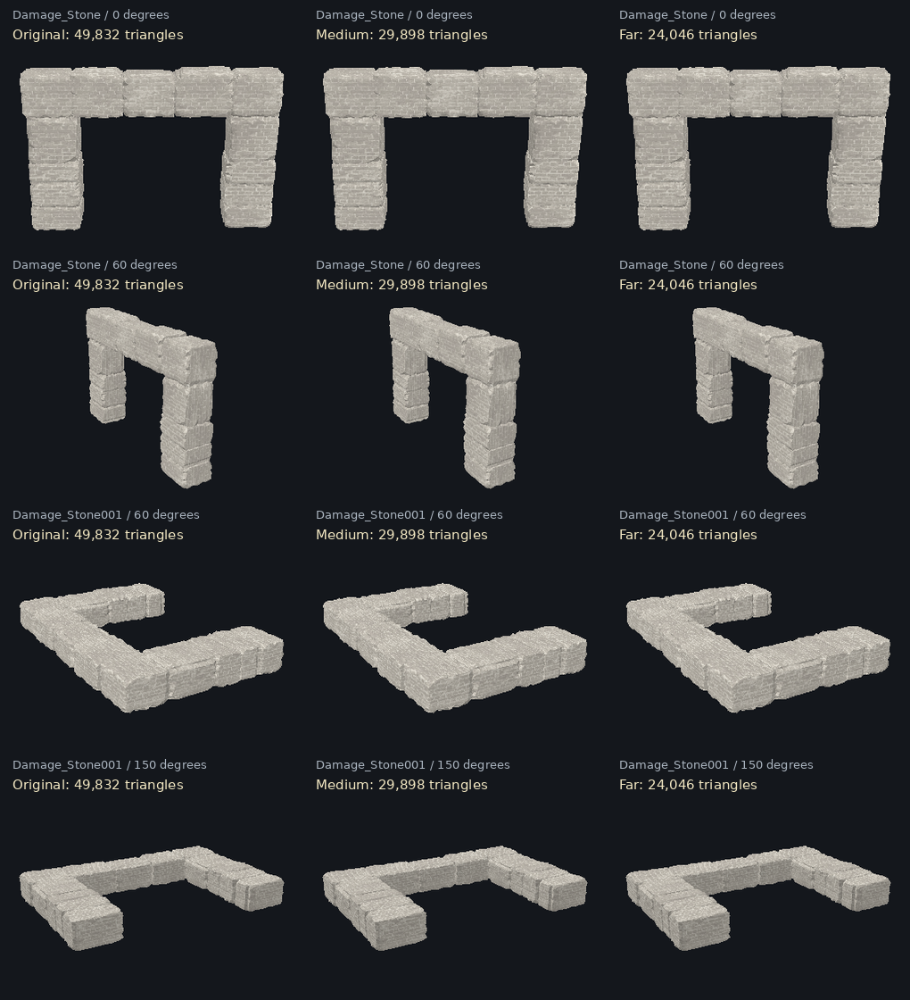

# Performance improvements

Baseline: `634dcd2f93fb60677a8ecfe8eb18066d5d2320e1`.

The next branch, `perf/quality-preserving-runtime-2026-10-23`, adds a combined
runtime and loading pass on top of this work. See [the implementation and
validation notes](runtime-optimization.md). It adds live **Static batching** and
**Static transforms** controls alongside the existing Performance controls.

## Changes

- Stats graphs and GPU timestamp queries are opt-in. When enabled, one explicit
  timing scope covers the whole frame; stats-gl does not also wrap every pass.
- Renderer counters reset once per frame and accumulate the scene, outline,
  and output passes. Triangle totals include repeated passes and are not a
  count of unique geometry.
- Default interaction feedback is a warm, two-CSS-pixel silhouette border.
  The ordinary target draw writes its interior into the stencil buffer without
  changing its surface color. Only the selected geometry is drawn again with
  small screen offsets, rejecting interior pixels and testing scene depth.
  Rigid meshes batch eight offsets into one extra instanced draw per material
  group; skinned meshes use eight native skinning draws per group. There is no
  composer, full-scene redraw, blur, or offscreen render target in this mode.
  Original materials return on focus change. `highlight=outline` opts into the
  previous blurred border and its full postprocessing cost.
- Workshop, furniture, journey, and awards updates pause outside the house.
  On exit the house model detaches from the scene, avoiding hidden transform
  updates. Re-entry reattaches it with the same interaction state.
- Hidden bubbles skip instance matrix calculations and uploads. Their buffer
  uses dynamic usage; transparent furniture auras hide when their power is zero.
- The book mixer runs while opening or turning. Finished poses stay clamped.
- Camera debug geometry and helper updates run only when needed.
- Static building beams sharing a material are merged into root-local render
  meshes. In the current house, 61 source meshes become 2 render meshes while
  preserving all 5,104 triangles, positions, normals, UVs, and material references.
  The mirrored window bar keeps its original rendering. Source object names
  remain available; colliders and interaction objects are excluded.
- Two dense stone structures keep their full geometry close up and use optional
  index-only LODs at smaller projected size. Each has 49,832 original triangles,
  29,898 medium, and 24,046 far. Selection uses estimated CSS-pixel error with
  hysteresis; textures, vertex colors, normals, hierarchy, and colliders remain.
  The source GLBs are unchanged. `stoneLod=0` restores original geometry.
- Independent query switches allow controlled comparisons.
- Closed, outward-facing opaque house meshes use backface culling after an exact
  topology check. Open sheets, cutouts, glass, animation/morph geometry and custom
  render states retain their authored material. Shared materials are cloned only
  for eligible meshes, retaining textures and surface properties. The one-time
  audit runs during preload in short yielding slices, before entry shader warm-up.
- Hidden pages stop the 3D frame loop. Returning resets the clock and diagnostic
  windows instead of simulating the hidden interval; movement input also clears.
- `perfdiag=1` adds live LOD, backface-culling and pixel-ratio controls. The camera
  stays in place, avoiding URL reload/reposition differences. Normal visits keep
  their existing resolution; quality is not reduced automatically.
- Idle furniture point lights leave the visible light list until their effects
  activate. Active effects retain their colored lights and fade behavior. Faded
  intensity below 0.001 hides the light. `activeLightsOnly=0` restores the previous
  furniture membership independently of the workshop policy below.
- Workshop point lights are off while walking or in the collection overview.
  Inspecting a craft lights only that craft; closing it or leaving switches its
  light off immediately. The idle house uses 1 point light (main warm), rising
  to 2 during inspection, plus any active furniture effects. Both common light
  variants are compiled behind the house-entry cover. Sprites, runes, and
  emissive animations remain. Explicit `workshopLights=all` and
  `workshopLights=focused` retain the earlier appearances for comparison.
- Workshop tones use cached mono PCM WAV clips through HTMLAudioElement. This
  removes synchronous AudioContext construction from workshop entry. The same
  sine notes, envelopes, pitch drift, and quiet playback level are retained,
  with two reusable voices per cue/index. Muted/blocked playback stays optional;
  destroy pauses players and releases their object URLs.
- Player movement/collision still uses fixed 60 Hz substeps. Its skeleton is
  evaluated once per displayed frame using the same accumulated simulation
  delta. Physics diagnostic timing now excludes visual mixer evaluation.
- The exterior and NPC roots detach while indoors, avoiding matrix traversal
  of invisible scenery and skeletons. They reattach with their original state;
  NPCs finishing a background load while indoors also remain detached.
- Flat workshop/map glow rings use one double-sided transparent pass. Volumetric
  flame and water materials retain their existing rendering behavior.
- Interaction hints only write text/visibility when the label or state changes.
- Three GLBs use unfiltered Meshopt encoding without simplifying, quantizing,
  joining, flattening, renaming, or changing textures. The existing loader already
  includes the compatible decoder. The unused `house-webp.glb` is untouched.
- Type checking is now available; its existing animation-frame callback error
  in StartupLoading was corrected.

## Asset results

| Asset | Before (bytes) | After (bytes) | Reduction |
| --- | ---: | ---: | ---: |
| house.glb | 19,611,060 | 12,459,804 | 36.5% |
| world.glb | 8,741,240 | 5,362,764 | 38.6% |
| book.glb | 2,031,792 | 892,140 | 56.1% |
| Total | 30,384,092 | 18,714,708 | 38.4% |

The optimizer verifies decoded geometry, triangle winding, morph targets,
animation samples, scene hierarchy, names, transforms, texture bytes, and
material definitions before accepting each output. It restores tiny source
transforms that the serializer would otherwise omit as near-default values.
All source files were byte-identical to the three baseline repository assets.
The separately supplied older world.glb is not used by this revision.
The GLB size table excludes the optional stone LOD sidecar described below.

Compression reduces transfer size. It does not reduce triangle counts or
draw calls, and does not prove an FPS improvement.

## Run and verify

```sh
npm ci
npm run typecheck
npm test
npm run build
npm run dev
```

Tests cover query options, outline/direct render paths, complete frame counters,
hidden bubble uploads and reactivation, decoding all compressed buffers with
Three.js's bundled decoder, loading/sampling the book's morph animations, beam
world-space geometry/material preservation, exclusion of animated/gameplay
objects, and the actual house's 61-to-2 beam batching result. Additional checks
cover fixed physics/mixer cadence, accumulated animation time/pose, light
activation and fading, 12-to-5 idle light membership, flat-ring materials, hint
DOM changes, exterior/NPC restoration, and NPC loading while indoors. There are
34 tests. The latest checks exercise inspection-only workshop light transitions,
shader warm-up restoration on success/failure, one scene submission for the
border, unchanged surface colors, flat double-sided doors, alpha cutouts,
world transforms, hidden/detached sources, shared-material isolation/restoration,
skinning and morph poses, instanced transforms/count changes, CSS-pixel sizing,
owned-resource cleanup, optional legacy highlights/lights, WAV format/timing/pitch,
bounded voice reuse, mute/blocked playback, and audio resource cleanup. Stone
checks cover the real asset and sidecar, near-detail restoration, projected
size/zoom/world-scale selection, hysteresis, orthographic cameras, shared-buffer
ownership, stale/corrupt data fallback, external replacement, inactive house
updates, and preservation of other geometry, materials, transforms and hierarchy.

The new border has isolated pixel validation using actual emitted Three.js
WebGLProgram shaders on Mesa llvmpipe through a surfaceless EGL OpenGL ES 3.2
context. Surface, rigid border, alpha-cutout surface/border, skinning, and morph
shader variants compile/link. A 256×256 flat-door fixture preserves every interior
pixel, draws the expected two-pixel exterior rim (1,004 changed rim pixels with
a foreground strip), respects foreground depth, leaves cutout openings open,
and clears cleanly after deselection. The rendered fixture was visually reviewed.
This is software-rendered shader/state validation, not full browser gameplay or
a hardware performance benchmark. Earlier browser tests could not create WebGL.
Walk around outside, enter and exit twice, open/turn the project book both ways,
use workshop/map/awards, and toggle the furniture effects on your computer.
The existing Vite warning about a large JS bundle remains. This partial local
checkout also reports an unresolved `/assets/edge-mask.webp` URL at build time;
that public asset exists in the remote branch and is preserved by this change.

## Controlled captures

Keep the same browser, window dimensions, scene, route, and loading state.
Reload between configurations and wait for assets and shaders to settle.
Use the existing 20-second collector on each run. Disable stats in ordinary
captures to avoid measuring their overhead.

| URL query | Purpose |
| --- | --- |
| `?perfdiag=1` | Current defaults: stencil border, inspection-only workshop lights, stats off |
| `?perfdiag=1&outlines=0` | Disable interaction highlighting (legacy switch name) |
| `?perfdiag=1&highlight=outline` | Original multi-pass blurred border highlight; higher rendering cost |
| `?perfdiag=1&shadows=0` | Shadow cost only |
| `?perfdiag=1&dpr=1` | Resolution cost only |
| `?perfdiag=1&decorativeLights=0` | Furniture/workshop light cost; glow sprites remain |
| `?perfdiag=1&workshopLights=inspect` | Explicitly keep the default inspection-only light behavior |
| `?perfdiag=1&workshopLights=all` | Keep all four workshop point lights on, including while walking |
| `?perfdiag=1&workshopLights=focused` | Opt into one focused workshop light; changes illumination on other crafts |
| `?perfdiag=1&beamBatching=0` | Original separate beam meshes for comparison |
| `?perfdiag=1&staticBatching=0` | Disable additional local decoration/exterior batches; beam batching remains independent |
| `?perfdiag=1&staticTransforms=0` | Disable authored static local-transform freezing |
| `?perfdiag=1&stoneLod=0` | Original full-detail stone geometry at every distance |
| `?perfdiag=1&activeLightsOnly=0` | Include idle zero-power furniture lights; workshop policy is unchanged |
| `?perfdiag=1&stats=1` | CPU graphs enabled, GPU queries off |
| `?perfdiag=1&gpuStats=1` | Stats including GPU queries |
| `?perfdiag=1&lowfx=1` | Combined outlines/shadows/GPU-stats off and DPR 1 |

Stats graphs are visible whenever explicitly enabled, independently of the
debug UI. Normal DPR remains native, capped at 2. Explicit `dpr` values are
clamped between 0.5 and 2 and do not exceed native DPR. `lowfx=0` disables lowfx.
Decorative lights stay enabled by default, including in lowfx, for comparison
with the previous lowfx behavior. The decorative-light switch leaves the main
interior lights enabled.

The collector labels every configuration without `lowfx=1` as `normal`;
keep its complete recorded URL with each report or rename downloads to identify
the separate switches. The old captures are historical baselines: default stats
and full-frame counter behavior changed, so collect a fresh baseline first.
Renderer CPU timing measures JavaScript submission, not GPU execution.

## Reproduce asset compression

Keep the original Blender/export files. Copy the uncompressed exports into an
ignored `asset-sources` directory named `house.glb`, `world.glb`, and `book.glb`.
Then run:

```sh
npm run assets:optimize
npm test
```

Default output is `public/assets/models/environment`. Source and output
directories must differ. Custom locations are supported:

```sh
node scripts/optimize-assets.mjs /path/to/originals /path/to/output
```

After replacing/re-encoding the house, regenerate its optional stone LOD data:

```sh
npm run assets:stone-lods
```

This reads the current `house.glb` and writes only `house-stone-lods.json`.
It never rewrites a source GLB. Custom input and output paths can be passed to
`node scripts/generate-house-stone-lods.mjs input.glb output.json`.

Each output replaces the destination only after its checks pass. Original
exports also remain available in Git at the baseline commit above. Never use
an optimized output as the source for later art edits.

## Remaining investigation

### Follow-up captures, before beam batching

The warmed captures supplied on October 21 used identical window and canvas
dimensions. Both had stats/GPU stats disabled, shadows and decorative lights
enabled. Geometry counts were nearly stable (normal 533–534, outlines off 537).

| Metric | Normal | Outlines disabled |
| --- | ---: | ---: |
| Average FPS | 19.8 | 22.6 |
| Median frame time | 33.4 ms | 16.9 ms |
| 95th percentile frame time | 116.9 ms | 116.7 ms |
| 99th percentile frame time | 183.6 ms | 150.1 ms |
| Frames over 100 ms | 47 / 395 | 36 / 450 |
| Main-thread long tasks | 7 | 0 |

The outlines-off run was 14.1% faster on average, but the normal run's six
diagnostic snapshots also had outlineActive=false. Sparse snapshots do not
measure how long outlines were active between samples, and visible mesh/triangle
counts varied with camera direction. The entire improvement cannot be assigned
to outline rendering from this pair alone. Both reports had zero errors/warnings.
Long frames persist without recorded main-thread long tasks in the second run;
their cause is not identified by the collector.

### Next rendering change: small static beams

Beam batching targets CPU draw submission overhead without changing topology.
With every eligible beam visible it replaces 61 submissions with 2 per scene
pass. It does not reduce all scene rendering to two calls. Only a small set of
5,104 beam triangles shares coarser culling; large walls, high-poly stones, and
furniture keep their individual bounds. Transparent, mirrored, morphed, animated,
hidden, specially rendered, collider, and interaction meshes are excluded.
The batch uses the original material objects and shadow/layer settings.

This revision is enabled by default and can be disabled with beamBatching=0.
It passed CPU structural/transform tests and a production build, but GPU visuals
and FPS still require local verification. For a first capture, use
`?perfdiag=1&outlines=0` again after updating the branch and walking through the
house once. Compare it to the previous 22.6-FPS outlines-off capture while
checking that beams/window bars and interaction highlights still look correct.

### Chrome trace findings and follow-up changes

The uploaded trace used `?perfdiag=1&outlines=0`. Its TypeScript source maps
match the code before these trace-driven changes. The supplied graphics status
confirms hardware-accelerated WebGL through an Intel GPU, not software rendering.

The analysis excludes the CPU-profiler startup period (roughly 0.95 s). The
steady window contains 422 animation-frame callbacks over 20.83 s. Callback
duration averages 16.92 ms with a 24.78 ms 95th percentile; the median interval
between callbacks is 49.93 ms. These timings include recording overhead and
should not be treated as a fresh unprofiled FPS benchmark.

V8 samples attribute approximately 5.19 s of 6.68 s in `Game.update` to the
renderer (about 78%). `World.update` accounts for about 1.16 s, including 0.53 s
in the player AnimationMixer. These are inclusive sample estimates: nested
rows must not be added together. The source confirms that mixer work was
repeated in the fixed-step loop in the recorded version. InteractionHint.show
accounts for about 0.11 s and rewrites unchanged text.

Scene matrix traversal appears prominently too: invisible exterior meshes and
NPC skeletons stay attached and receive matrix updates. They are now detached
indoors. The fixed-step animation change removes repeated skeletal evaluation
while preserving the amount of simulated animation time.

The GPU-process main thread spends about 20.68 s within task spans but only
7.40 s of thread CPU time in those spans. This includes substantial waiting;
it is not a measurement of hardware GPU utilization or shader execution time.
The trace supports further work on the graphics path but does not identify an
exact per-mesh GPU cost. It does not justify changing Chrome acceleration flags.

The code also creates seven zero-intensity furniture point lights. Invisible
lights are excluded from Three.js's light list; retaining zero-power lights
otherwise keeps their shader slots and uniforms. They now start hidden and
participate only during their effect/fade. The existing interior point light
and four workshop lights stay enabled. Renderer diagnostics report the visible
point-light count. Light-count changes can compile/cache additional shader
variants on first activation; check the effect controls and warm them once
before collecting a new steady-state capture.

Flat double-sided transparent rings previously took front/back passes. They
now set forceSinglePass, as described in the [Three.js material documentation](https://threejs.org/docs/pages/Material.html#forceSinglePass).
The change applies only to flat workshop/map rings. All tests, type checking,
and the production build pass. The following capture provides performance
evidence; GPU visuals still require local review. No asset simplification is
included.

### Follow-up trace after the lighting and animation changes

`Trace-20261021T233508.json.gz` records the same
`?perfdiag=1&outlines=0` URL as `Trace-20261021T230512.json.gz`. Its sampled
Player functions include the new `updatePhysics` and `updateAnimation` methods.
Unlike the earlier trace, it embeds no application TypeScript source maps, so
the exact application source revision cannot be independently verified from
this recording alone.

Both analyses exclude profiler startup (about 0.92 s in the new trace) and use
the window from the first animation-frame callback to the end of the last.
The new window contains 669 callbacks over 23.32 s. FPS below is calculated from
callback intervals, not measured screen presentations.

| Metric | Earlier trace | Follow-up trace |
| --- | ---: | ---: |
| FPS from animation-frame intervals | 20.23 | 28.66 |
| Mean animation-frame callback work | 16.92 ms | 9.20 ms |
| 95th percentile callback work | 24.78 ms | 15.15 ms |
| Median callback interval | 49.93 ms | 33.31 ms |
| 95th percentile callback interval | 71.54 ms | 63.77 ms |
| Intervals over 100 ms | 5 / 421 | 1 / 668 |

This is 41.7% higher callback FPS and 45.6% less mean callback work in the
supplied recordings. Camera paths, interaction modes, effect activation, and
recording overhead are not controlled by the URL. These observations support
the direction of the changes but cannot isolate their individual gains or
promise the same FPS improvement throughout the project.

Inclusive V8 sample estimates, divided by the number of callbacks, also fell:
renderer 12.29 to 5.89 ms, World.update 2.75 to 0.79 ms, matrix traversal 2.31 to
0.73 ms, and player AnimationMixer evaluation 1.26 to 0.34 ms. InteractionHint.show
fell from 0.26 to about 0.005 ms per callback. Nested estimates overlap and must
not be summed. Rendering still represents about 81% of sampled Game.update
work, so further physics tuning is not the first priority suggested by this
capture.

GPU-process task spans total about 22.78 s with 8.39 s of thread CPU time in the
new window. This still includes substantial waiting and does not report GPU
hardware utilization or identify an individual mesh's GPU cost. No additional
runtime changes were made in response to this capture.

### Decorative-light comparison and workshop changes

The next pair of supplied traces uses these URLs, respectively:

- `Trace-20261021T235306.json.gz`: `?perfdiag=1&outlines=0`.
- `Trace-20261021T235608.json.gz`:
  `?perfdiag=1&outlines=0&decorativeLights=0`.

Both report host DPR 1 and the same application-module HMR URLs, but embed no
application source maps. Analysis excludes profiler startup (about 0.61 and
0.63 s) and uses the first-to-last animation-frame callback window. CPU-profile
chunks are joined by process/profile ID: Chrome emits these chunks on a profiler
worker thread, different from the sampled renderer main thread.

| Metric | Decorative lights on | Decorative lights off |
| --- | ---: | ---: |
| Callback window | 23.17 s | 26.32 s |
| Animation-frame callbacks | 809 | 1,379 |
| FPS from callback intervals | 34.90 | 52.38 |
| Mean callback duration | 10.72 ms | 10.31 ms |
| 95th percentile callback duration | 18.05 ms | 17.79 ms |
| Median callback interval | 31.79 ms | 16.92 ms |
| 95th percentile callback interval | 49.70 ms | 30.12 ms |
| Longest callback interval | 329.09 ms | 345.42 ms |

Disabling the decorative lights coincides with 50.1% higher callback FPS while
mean JavaScript callback duration changes only 3.8%. The five-second windows
range from 29.5-40.5 FPS with the lights on and 45.1-59.2 FPS with them off. This
supports graphics-side lighting as the next priority. These recordings still
include different camera/interaction sequences and profiler overhead; the
numbers do not isolate per-light GPU time or guarantee a 50% gain from the new
one-light policy.

The lighting modes retain all four auras, runes, artifact animations, and
emissive material pulses. Furniture effects keep their existing real lights.
The current default, described below, switches workshop lights off while walking
and illuminates only an inspected craft. Earlier all-four and nearest/focused
policies remain explicit comparison options. The recordings above predate the
current inspection-only policy and do not measure its FPS.

Both traces also identify a workshop-entry stall in WorkshopSound.play: about
295 and 302 ms of self-sample time on its setup line, with the entry interaction
inside a roughly 300 ms main-thread task. The source constructs an AudioContext
synchronously there, before scheduling the notes. The longest callback intervals
therefore persist with decorative lights disabled and should not all be assigned
to lighting or geometry.

WorkshopSound now renders the short sine cues to small PCM WAV buffers on first
use, caches two native media voices per cue/index, and calls media play without
constructing a separate AudioContext. First-use WAV generation and browser media
startup still have a cost; removal of the recorded stall has not been measured
on the user's Windows system. Tests verify cue duration/pitch, cache bounds,
global-mute callback, playback rejection handling, and cleanup. The clips contain
no downloaded audio and introduce no asset or package dependency.

### Silhouette border and inspection-only workshop lights

Source inspection confirms that the legacy OutlinePass renders a non-selected
depth scene and a selected-object mask, then runs edge detection, blur, and
compositing in addition to the normal scene/output passes. Re-enabling that path
can therefore restore substantial rendering work. This is an identified source
cost, not a new GPU timing measurement.

Default highlighting is a crisp warm silhouette border rather than a surface
color change. The existing scene draw keeps the original appearance and writes
stencil bit 1 for visible target pixels. Late, unlit copies of only that target's
geometry shift by two CSS pixels in eight directions. The stencil test rejects
the interior; the depth test keeps foreground objects in front of the rim.
Screen-space offsets also work for flat/open door planes, unlike expansion
along normals alone. Width follows DPR and resize. Texture alpha cutouts remain.

Rigid geometry uses one eight-instance draw per material group. Native source
instances repeat their transforms for each offset, uploading only on transform
or count changes. Skinned meshes use eight draws per group and share the source
skeleton and morph pose. Rigid morph weights use Three's native instanced morph
texture and upload only on changes. These are additional selected-object draws
and vertex work; there is no claim of zero overhead or a measured FPS gain.
There are no extra full-scene passes, blur textures, or default composer.

Only selected materials are cloned for stencil writes, leaving shared materials
outside the target untouched. Surface color, emission, textures, and authored
material animation remain; original material/array references return on focus
change. Proxies follow world transforms, skip hidden/detached sources, cannot
be raycast targets, and release their own materials/buffers/morph textures on
clear without disposing source geometry, maps, or skeletons. Invisible hit
helpers, custom vertex/shader materials, BatchedMesh, and source InstancedMesh
with per-instance morph textures are excluded. Full transparency is a crisp
silhouette rather than a translucent glow; no through-wall hidden edge is drawn.

The workshop's default `inspect` policy has no real point lights while walking,
entering, in the overview, hovering without selection, or leaving. E/Enter,
click, or arrow selection inside the workshop illuminates that craft only;
closing the selection or leaving turns it off immediately. The main house light
is independent. Zero/one-workshop-light shader variants compile while the
house-entry overlay covers the screen, preserving visibility/state afterwards
even if compilation fails.

For local review, open `?perfdiag=1` after pulling. Remove previous overrides
such as `workshopLights=all`, `workshopLights=focused`, `highlight=outline`,
`outlines=0`, `lowfx=1`, and `decorativeLights=0`. Check that nearby interactables
receive a thin exterior rim with their surface colors intact, the rim disappears
when moving away, workshop overview has no point light, and selecting/closing/leaving correctly switches
the individual craft light. Idle diagnostics should read pointLights=1, rising
to 2 for workshop inspection, plus active furniture lights. In default mode,
highlightMode=border and outlineActive=true while a target is selected;
postprocessOutlineActive=false confirms the old OutlinePass is bypassed.
`highlight=outline` explicitly restores the legacy blurred border and its cost.
Full-game appearance, post-change FPS, and Windows audio playback still need
local review; no new measured FPS gain is claimed.

### Uploaded exterior source audit

The separately supplied `world.glb` is 7,981,548 bytes with 157 nodes, 182 mesh
primitives, and 232,176 triangles. Two nodes contain 219,904 triangles (94.7%):

| Node | Triangles |
| --- | ---: |
| Cube_Material.002_0 | 124,063 |
| Cube_Material.002_0.001 | 95,841 |

Their accessor bounds, exported transforms, and triangle counts match the same
nodes in the repository's original runtime world. The supplied `portfolio.blend1`
backup contains the same two objects with 124,063 and 95,841 triangular faces,
respectively. The backup was inspected through its file blocks and DNA layout;
it was not opened or rendered in Blender.

Both supplied sources omit the current project's COL_, INTERACT_, ZONE_, and
SHADOW_ object tags. The GLB lacks, for example, INTERACT_DOOR_01 and ZONE_DOOR_01.
They therefore cannot directly replace the runtime asset without restoring
gameplay metadata. The repository world remains unchanged.

These dense meshes are candidates for an exterior-only simplification study,
preserving current runtime names, colliders, and interactions and comparing
silhouettes/normals before accepting an output. Their triangle share does not
measure GPU time. They also cannot explain indoor rendering costs while their
exterior root is detached. This audit does not justify replacing or decimating
the scene automatically.

### Geometry and remaining stalls

The house still has roughly 361k triangles and 366 exported mesh primitives.
Its two largest stone meshes contribute about 100k triangles. Simplification
and static batching need visual comparison and interaction exclusions before
they can be accepted. The world has roughly 240k triangles; two meshes account
for about 220k. Rendering passes can submit these triangles more than once.

The early 327-333 ms stalls were not attributed to a function. The later light
comparison reproduces a similar workshop-entry stall in WorkshopSound.play,
which is addressed above. This does not establish that every historical stall
had the same cause. Observed FPS changes apply to the supplied traces, not a
controlled benchmark of each optimization.

### Stone geometry LODs

Only the decoded runtime nodes `Damage_Stone` and `Damage_Stone001` are eligible.
The latter comes from Blender's `Damage_Stone.001`; GLTFLoader sanitizes its name.
They are the two 49,832-triangle stone structures in the current house, not
replacement assets from the separately uploaded older exterior sources.

| Detail | Per structure | Both structures | Reduction on these two meshes |
| --- | ---: | ---: | ---: |
| Original, close up | 49,832 | 99,664 | 0% |
| Medium | 29,898 | 59,796 | 40.0% |
| Far | 24,046 | 48,092 | 51.7% |

The offline generator runs attribute-aware Meshopt simplification with locked
borders, using decoded normals, UVs, and both normalized vertex-color streams.
It welds only identical complete attributes and keeps indices addressing the
original vertex buffers. Position/normal/UV/color data is never recomputed or
quantized. The medium relative-error limit is 0.00025 and the far limit is
0.0005; the algorithm may stop above the requested triangle ratio to respect
seams, topology and error. It does not force a lower count using a permissive
or sloppy pass. The decoder round-trip preserves each triangle's winding.

Runtime selection estimates pixel error using the reported local error, maximum
world scale, camera projection, viewport CSS height, and nearest bounding-sphere
depth. A coarser level enters below 0.75 estimated CSS pixels and exits above 1;
close views return the original geometry. This error metric is approximate,
not a guaranteed image-space bound. Source meshes, names, parents, transforms,
materials, bounding volumes and collider geometry stay in place. Only the render
mesh's geometry/index selection changes; no new render objects or draw calls
are introduced. The LOD vertices share the original GPU attribute buffers.

The optional JSON adds 1,137,481 bytes (local compression estimates: 716,098 gzip,
497,807 Brotli; actual HTTP encoding depends on hosting). The four decoded extra
index buffers total 1,294,656 bytes, with that additional GPU index storage if
all levels are uploaded. This trades some download/index memory for less runtime
geometry work; it does not reduce the already-compressed GLB download further.
The sidecar loads after the house is ready and never gates entry. Fingerprinting
preparation yields between attribute streams. Missing/unsupported data, decode
errors, a SHA-256 mismatch in source attributes/indices, or invalid indices keep
the original geometry. Re-exporting a house requires regenerating the sidecar.

All 43 tests currently pass. Regeneration produced a byte-identical sidecar twice.
Isolated software-rendered QA compares the original and both LODs for two meshes
at four angles, both with the complete structure framed and near the far-LOD
switch threshold: 32 comparisons at 512×512. It uses the source albedo, UVs,
vertex colors, normals and world transforms under consistent diffuse lighting.
The observed minimum silhouette intersection-over-union and maximum surface
RGB error are recorded in [the review results](house-stone-lod-review.json).
No silhouette discrepancy extended beyond one pixel. The images were visually
reviewed. This does not verify full browser/PBR gameplay or establish a hardware
FPS gain. Check close/distant views and camera movement on the user's system.



For A/B captures, compare `?perfdiag=1` with `?perfdiag=1&stoneLod=0` using the
same camera route, dimensions and warmed assets. Keep border and workshop-light
settings identical. `[House physics]` includes `houseStoneLod.sourceTriangles`
and `houseStoneLod.selectedTriangles`; these are the two meshes' chosen index
counts, not the number of triangles actually visible after frustum culling.
The independent `stoneLod=0` option skips sidecar loading and selection while
retaining the other rendering improvements.

### Same-camera controls and solid-surface culling (2026-10-23)

The local Chrome captures on 2026-10-22 confirmed stone LOD selection (53,944 of
99,664 source triangles in one fireplace view). Both warmed captures were around
28 FPS, but camera placement and browser load differed. They do not establish an
isolated FPS gain. Further comparisons can now use a single diagnostic tab:

1. Open `?perfdiag=1`, enter the house, and choose a stationary view.
2. Under **Performance**, use **Stone LOD** and **Backface culling** independently.
   Turning LOD off restores authored indices immediately; re-enabling it reuses
   the validated data, or loads it once if the page started with `stoneLod=0`.
3. Use **Restart readings** after positioning, then allow approximately five
   seconds for the two-second warm-up exclusion and the next three-second sample.
4. Compare the same settings with a lower **Pixel ratio** if investigating pixel
   shading cost. It is capped at the lower of native DPR and 2, survives resizing, and keeps the
   border at the same CSS-pixel width. Changes commit when editing/dragging ends.

Live switches reset diagnostic windows and log their current state; they do not
rewrite the URL. `surfaceCulling=0` independently disables solid-surface culling.
`[House physics]` also reports `houseSurfaceCulling` and the selected stone counts.

Every material in the repository house initially has `DoubleSide`. The new
preparation checks exact decoded positions and directed triangle-edge pairs,
welding UV/normal seam duplicates without changing any geometry. Each edge must
have exactly two opposite uses, and every disconnected shell must have positive
signed volume. Inward cavities, ambiguous topology, alpha/transmission effects,
partial draws, animation and custom render/depth states are left alone.

In this repository export, **132 eligible meshes / 108,050 submitted triangles**
use front-face materials with 50 shared material clones. The last captured local
house export independently qualifies 134 meshes / 108,122 triangles. This reduces
backface rasterization; it does **not** reduce draw calls, submitted triangle
counters, downloads or collider geometry. The mixed-orientation stone structures
retain their original material and their existing index-only LOD behavior.

The audit inspects the actual loaded export, so no additional sidecar can become
stale after Blender re-export. It took about 0.8 seconds in isolated CPU tooling
here, in yielding slices during preload. This is a one-time preparation cost,
not a frame cost; device timings will differ. Existing GLB and Blender bytes are
unchanged. The supplied `portfolio.blend1` is the earlier exterior source, not
the current house asset, so no Blender re-export was needed for this pass.

The [surface review](house-surface-culling-review.json) records 792 isolated
256×256 software-rendered comparisons: 132 meshes × six exterior views. All
have identical silhouette coverage; small shading differences remain (maximum
whole-image mean channel error 0.156/255). This verifies geometry coverage in
those views, not full browser/PBR gameplay or hardware performance. A local
visual/FPS review remains required before claiming a speed gain.
