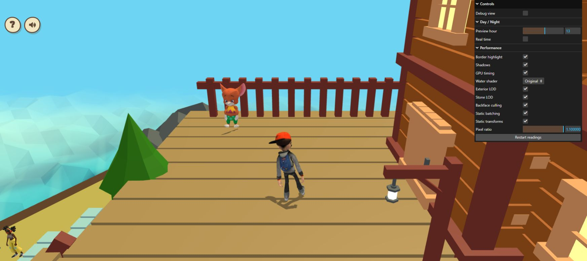
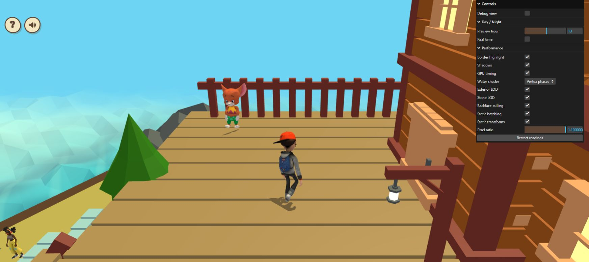

# Water shader comparison

The Performance folder under `?perfdiag=1` now offers **Water shader**:

| Mode | Purpose | Default |
| --- | --- | --- |
| Original | Existing animated, lit water shader | Yes |
| Vertex phases | Candidate with affine spatial wave arguments computed per vertex | No |
| Depth only (diagnostic) | Opaque water depth coverage without water color shading | No |

Normal gameplay uses Original. `?waterShader=vertex` opts into the candidate.
`?perfdiag=1&waterShader=depth` selects the isolation view; without explicit
diagnostics, requesting depth falls back to Original. Unknown values also use
Original. None of these modes changes resolution, water geometry or colliders.

## Scope

The shipped world contains one animated `Water_Surface` mesh, `Cube048_1`, with
4,802 triangles. Its world bounds at the runtime quarter scale are approximately
132.7 × 3.5 × 136.0 units. Its source roughness is retained by the original and
candidate factories, including the authored negative value; this change does
not normalize or reinterpret the export's material parameters.

Other `Water` and `Water_Sides` materials, including the pond, remain untouched.
There is no `Water_Horizon` material in the current world. The existing horizon
shader still supports the same comparison if that material is used in a future
export. Counts and actual selected mode appear in `[House physics]`; renderer
windows also record the requested `waterShader` value.

## Candidate and limits

Wave arguments have a spatial part such as `0.55 * worldX + 0.22 * worldZ`,
followed by a time offset and a sine. The spatial parts are affine and can be
interpolated before applying the sine. The candidate moves only these spatial
linear expressions to the vertex shader. Sines, time offsets, smoothstep,
radial horizon fade, color mixing, standard lighting, flat normals and fog remain
in the original fragment path. Vertex positions are unchanged. Materials in
all modes share one advancing animation clock and are created lazily/reused,
so switching does not restart water animation.

The live comparison below did not establish a GPU benefit for the candidate.
Extra interpolated values may offset the saved fragment arithmetic, and the
driver can optimize either program. Floating-point evaluation order differs
even though the expressions agree in real arithmetic. Original remains the
default; the candidate remains available only for explicit comparison.

The depth diagnostic uses an opaque Basic material with color writes off and
depth testing/writes on for the animated surface slots. The altered appearance
is intentional. Non-water slots stay authored. It retains surface depth
coverage rather than simply hiding the mesh, but material sorting, early depth
behavior and previously rendered color can still affect the comparison. A GPU
delta estimates the combined rendering effect; it is not an exact additive
measurement of one shader. It leaves the other water materials shaded normally.

## Live procedure

After pulling, refresh `http://localhost:5173/?perfdiag=1` and keep one exterior
camera, fixed preview hour, native DPR, shadows and LOD settings:

1. Enable GPU timing. Let each mode compile once before taking readings, then
   use Restart readings to exclude the first-use work.
2. Capture Original → Depth only → Original to estimate animated-surface cost.
3. Capture Original → Vertex phases → Original. Retain repeated baseline windows
   and compare the same view, including a view with large water coverage.
4. Inspect the waves, highlights, flat-surface shading, horizon transition and
   day/night lighting while switching Original/Vertex phases. The clock keeps
   advancing, so screenshots are not frozen-time pixel comparisons.
5. Restore Original, GPU timing off, native DPR, shadows and real time after
   testing unless a later measured/visual review explicitly changes the default.

## Validation — October 26, 2026

All **99 local tests**, typecheck, production build and whitespace checks pass.
The four new regressions check lazy material reuse, shared clock, depth state,
mixed slots, disposal ownership, actual world geometry/material identity,
diagnostic URL gating, and the generated shader expressions. The Original GLSL
matches hashes generated from the preceding implementation after whitespace
normalization. Tests evaluate the actual old/new scalar shader expressions
across interpolated triangles and time samples, including long sessions, to
check real-arithmetic wave equivalence; this does not emulate GPU precision.

The active near-water variants compiled and rendered in the owner's live WebGL
page with no error logs returned. The unused horizon branch has only local
coverage. No GPU/FPS or pixel-equality gain is claimed. The existing larger-chunk and
partial-checkout edge-mask build warnings remain. Local house-dependent tests
use the prior house; the owner previously confirmed the earlier 93-test suite
with the newer house export. No GLB/Blender source, textures or dependencies
change in this follow-up.

## Live comparison — October 26, 2026

The new Water shader control was present in the owner's existing local tab.
The expected branch head was `bfaa7358e915dfd4c97b6a08d087483da78c8af6`; the
browser source revision was not independently fingerprinted. One unchanged
normal gameplay camera at the cottage deck spawn was used throughout, without
debug overlays or camera/player input. Preview hour was fixed at 13, CSS viewport
1745 × 777, framebuffer 1919 × 854 and DPR 1.1. Shadows, border highlighting,
exterior/stone LOD, culling, batching and static transforms remained on. No point
lights were active. The world reported one animated water mesh and both exterior
LOD targets at 87,960 selected triangles.

Each condition used Restart readings and its two-second warmup exclusion,
followed by 18 seconds before collecting the latest five reporting windows.
Vertex phases had three additional seconds to settle after first selection.
The sequence yielded 25 renderer windows with **131 completed, ready GPU
queries, zero disjoint events and at most one pending query**. The GPU column is
the median of five window means, not a pooled per-frame median.

| Condition | GPU ms | GPU window means, ms | Renderer CPU ms | FPS | Queries |
| --- | ---: | --- | ---: | ---: | ---: |
| A1 Original | 21.14 | 20.92, 21.42, 20.72, 21.36, 21.14 | 4.67 | 17 | 26 |
| B Depth only | 20.05 | 20.37, 19.78, 20.12, 20.05, 19.92 | 4.97 | 17 | 26 |
| A2 Original | 20.79 | 20.86, 20.78, 21.20, 20.71, 20.79 | 5.19 | 17 | 26 |
| C1 Vertex phases | 20.78 | 20.58, 20.78, 20.82, 20.72, 21.28 | 5.15 | 17 | 25 |
| A3 Original | 20.70 | 20.70, 20.98, 20.76, 20.52, 20.69 | 5.66 | 19 | 28 |

All 25 windows reported **149 draws and 221,476 triangles**, with the expected
mode and unchanged rendering options. Renderer CPU and FPS are also medians
of reporting windows. Animation continued, another deployed portfolio tab
remained open, and external load/GPU clocks were uncontrolled.

Depth isolation reduced the reported GPU time by 0.74–1.09 ms relative to its
surrounding originals, about 4–5%. This suggests a modest combined effect of
animated-surface shading in this camera, subject to the depth/sorting caveats
above. It does not explain most of the roughly 21 ms GPU frame or isolate the
other water materials. The vertex candidate's 20.78 ms lies within the
surrounding originals' 20.79/20.70 ms variation. **No measurable candidate GPU
benefit or consistent FPS gain was established; Original stays the default.**

No obvious discrepancy in wave scale, color, flat shading or silhouettes
appeared in the inspected native-resolution daytime view. Animation time was
not frozen, so captures are not pixel comparisons. Close-up/all-angle and
candidate day/night visual coverage remain incomplete. The near-water programs
rendered without returned console errors; the current world does not exercise
the horizon branch.

Original, native DPR, shadows and real time were restored, GPU timing disabled,
and exterior LOD left enabled. This follow-up changes documentation only; no
additional runtime, model or Blender changes were justified by these readings.

Raw logs, window summaries, method and restored UI:
[water-shader-live-2026-10-26.json](water-shader-live-2026-10-26.json).

Original at the measurement camera:

Vertex phases at the same camera, with animation continuing:

[Depth diagnostic appearance](water-shader-depth-2026-10-26.png) intentionally
differs. [Restored settings](water-shader-restored-2026-10-26.png) show real time
returning to the owner's nighttime clock, Original selected and GPU timing off.
